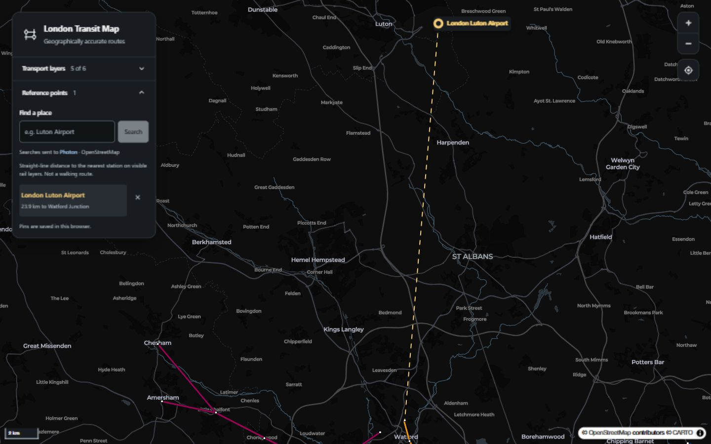

# London Transit Map

Explore London's public transport network on a geographic map. Show the lines you care about, add places as reference points, and compare their straight-line distance to the nearest visible rail station.

**[Open the map](https://iabadia.github.io/PublicTransportMap/)**



## Features

- **Transport layers:** Underground, Overground, DLR, Elizabeth line, Tram, and buses, with line colours and selectable stations or stops.
- **Individual Underground lines:** expand the arrow beside Underground to reveal 11 line toggles. The list starts collapsed; switching the master off preserves your choices until you switch it back on.
- **Reference points:** search for an airport, landmark, or address and select a result to pin it. Add multiple places, remove them individually, and keep them across reloads in the same browser.
- **Reactive comparisons:** each pin connects to the nearest station served by a visible rail line. Routes, stations, connectors, and distances follow the same filters. Interchanges remain eligible while any of their rail lines is visible.
- **Responsive controls:** collapsible panels, keyboard focus indicators, zoom controls, location control, and scale. The full-network overview accounts for outer stations and saved reference points.

## Use reference points

1. Open **Reference points** and search for a place, such as `Luton Airport`.
2. Select the intended result; similarly named airports, stations, and roads may appear separately.
3. Select the saved place or its marker to frame it with the nearest visible rail station.
4. Toggle transport modes or individual Underground lines to update the connector and distance.

Pins remain when all rail lines are hidden, but connectors disappear until a rail line is enabled. Pins are stored locally in your browser, not in an account or across devices. If browser storage is unavailable, they last only for the current visit.

### What the distance means

Distances are **straight-line kilometres to a station**, calculated from geographic coordinates. They do not measure distance to the nearest point along a track, walking distance, travel time, or an available journey. Bus stops are excluded from these comparisons. An airport's search result represents the place supplied by the geocoder, not necessarily a terminal entrance.

## Run locally

Use **Node.js 22.6 or newer**; Node.js 24 is used in CI. No API key is required by the current configuration.

```sh
git clone https://github.com/iAbadia/PublicTransportMap.git
cd PublicTransportMap
npm ci
npm run dev
```

Open [localhost:5173/PublicTransportMap/](http://localhost:5173/PublicTransportMap/). Vite reloads the app as files change.

| Command | Purpose |
| --- | --- |
| `npm run dev` | Start the development server |
| `npm test` | Test distances, mode/line filtering, pin validation, and search handling |
| `npm run lint` | Run ESLint |
| `npm run build` | Type-check and build the production site into `dist/` |
| `npm run preview` | Serve the production build locally |

The build also copies MapLibre's worker modules into `dist/assets/` so they can load under the deployment path.

## Data and external services

Rail and bus geometry is committed as GeoJSON in `public/data/`, generated from the TfL Unified API. It is a **static snapshot**, not live service information: the map does not provide departures, disruptions, live vehicles, or journey planning.

The basemap uses CARTO's dark map style and OpenStreetMap data, with attribution displayed on the map. Basemap resources and place search require an internet connection.

Place searches are sent only when submitted to the public [Photon geocoder](https://github.com/komoot/photon), which uses OpenStreetMap data. The interface discloses this beside the search field. This public service is best-effort and may throttle requests; substantial deployment traffic should use a dedicated instance. Pin storage and distance calculations happen in the browser.

### Refresh transport data

These scripts fetch new data and overwrite the corresponding committed GeoJSON files:

```sh
node scripts/fetch-tfl-rail.mjs
node scripts/fetch-tfl-bus.mjs
```

The bus refresh makes many API requests and can take time. Inspect the scripts' output and resulting data before committing: failed route requests may be skipped. Review the current [TfL API guidance](https://api.tfl.gov.uk/) before refreshing data at scale.

## Project structure

```text
src/components/     Map, transport layers, controls, station details, reference points
src/lib/            Line colours, shared rail filters, geographic calculations, framing
src/store/          Zustand state for visibility, selection, and reference points
public/data/        Rail and bus GeoJSON snapshots
scripts/            Data refresh, MapLibre worker copying, and tests
.github/workflows/  Validation and GitHub Pages deployment
.github/skills/     Project-installed Impeccable design skill
```

Built with React, TypeScript, Vite, MapLibre GL JS, Zustand, and Tailwind CSS.

## Deployment

Pushes to `main` trigger the GitHub Actions workflow: install dependencies, run tests and lint, build, and deploy to GitHub Pages. The workflow can also be started manually.

Vite's base path is `/PublicTransportMap/`. When hosting at a different repository path or domain root, update `base` in `vite.config.ts` accordingly. The repository's Pages source must be configured to use GitHub Actions.
